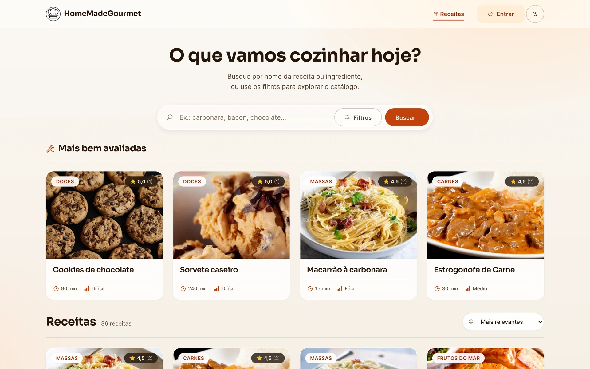
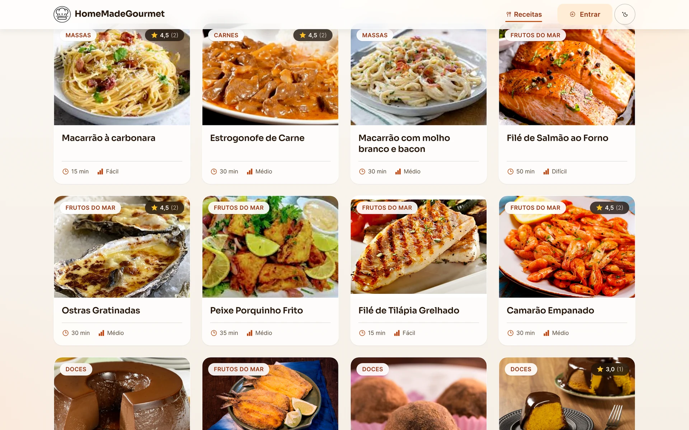
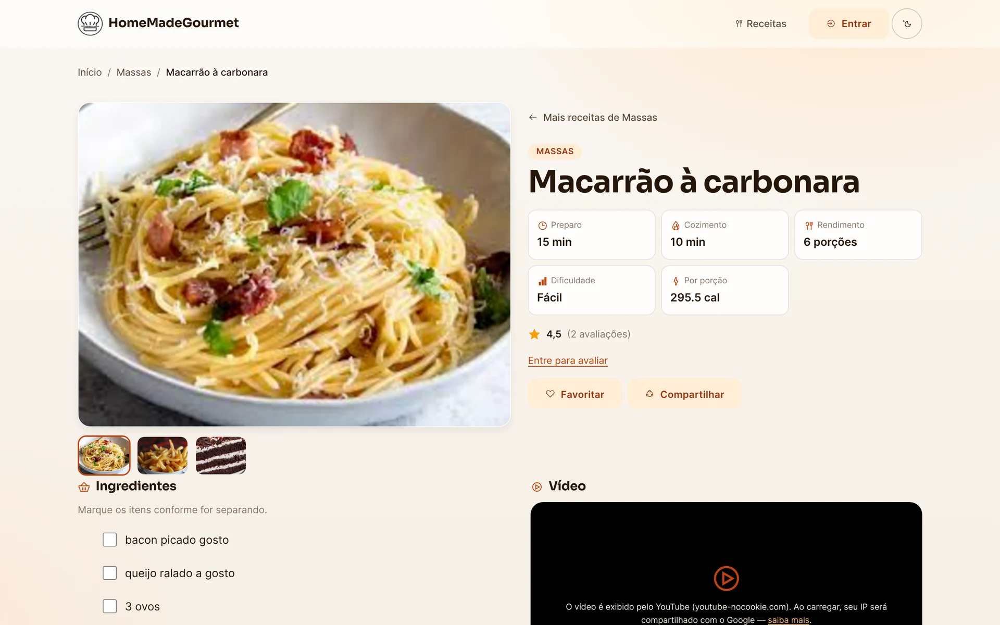
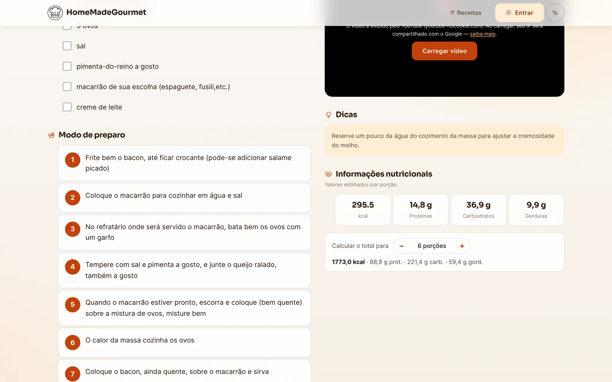
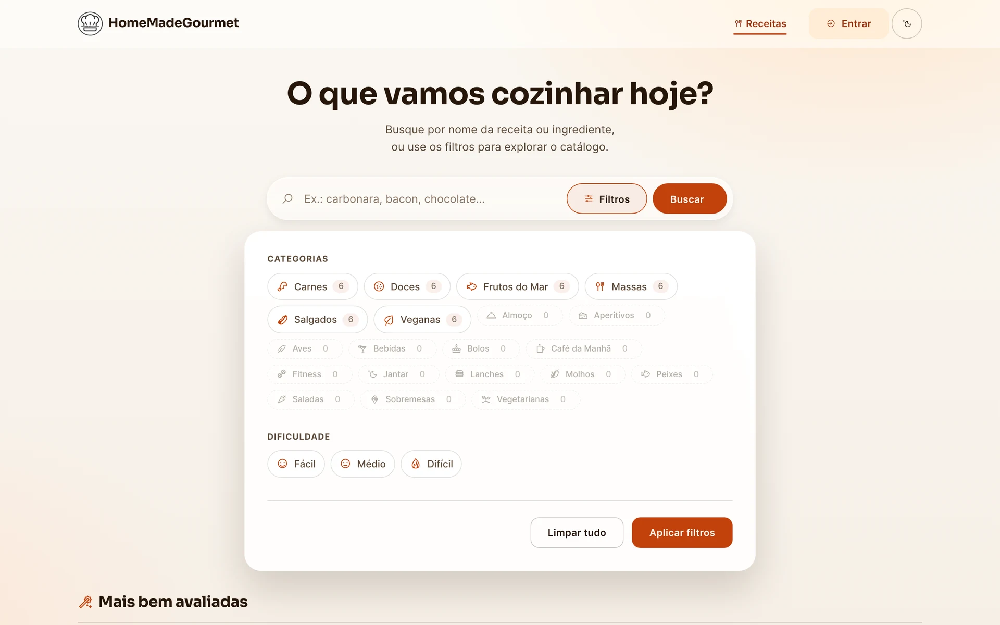
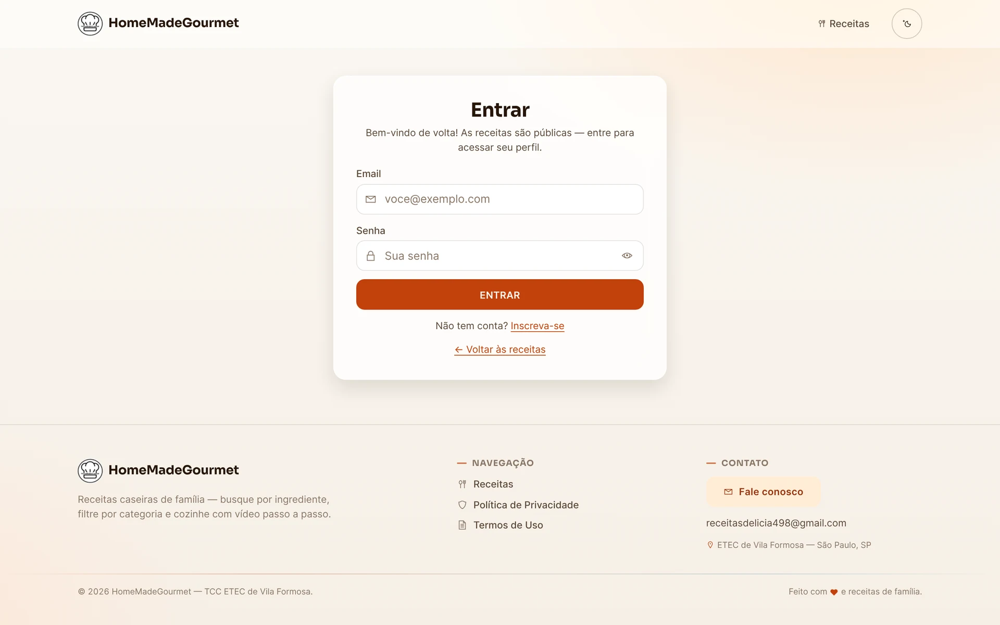
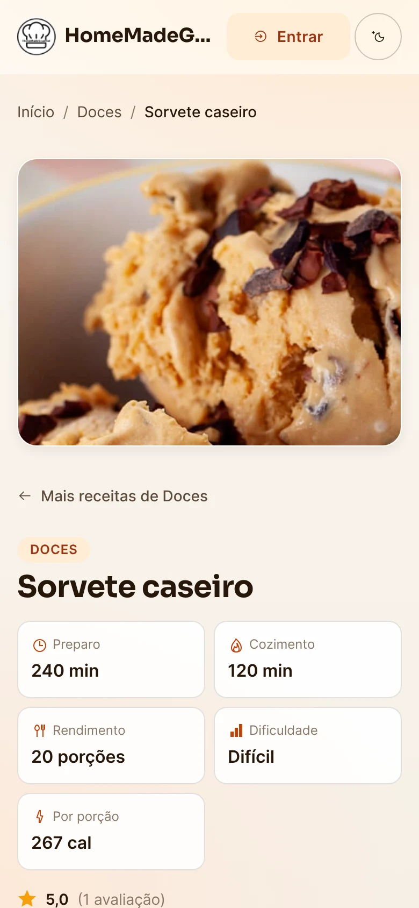

<h1 align="center">Portal Receitas — HomeMadeGourmet</h1>

<p align="center">
  Portal de receitas com catálogo filtrável, favoritos, avaliações e comentários.<br>
  TCC da ETEC de Vila Formosa (2022), reescrito em 2026 com <strong>Clean Architecture em PHP 8.2</strong>.
</p>

<div align="center">

[](https://receitas.gcruz.dev.br)
[](https://github.com/https-shini/Portal-Receitas/actions/workflows/ci.yml)
[](composer.json)
[](LICENSE)

</div>



<p align="center">
  <a href="https://receitas.gcruz.dev.br"><strong>Acessar a aplicação</strong></a> ·
  <a href="docs/architecture.md">Arquitetura</a> ·
  <a href="docs/backend.md">Backend</a> ·
  <a href="docs/frontend.md">Frontend</a> ·
  <a href="DEPLOY.md">Deploy</a>
</p>

> [!NOTE]
> A demonstração roda no plano gratuito do Render: o primeiro acesso após inatividade pode levar alguns segundos. O banco é recriado a partir do seed a cada reinício, então cadastros e avaliações feitos na demonstração não são permanentes.

---

## Sumário

- [Sobre o projeto](#sobre-o-projeto)
- [Problema e proposta](#problema-e-proposta)
- [Funcionalidades](#funcionalidades)
- [Capturas de tela](#capturas-de-tela)
- [Tecnologias](#tecnologias)
- [Arquitetura](#arquitetura)
- [Pré-requisitos](#pré-requisitos)
- [Instalação e execução](#instalação-e-execução)
- [Variáveis de ambiente](#variáveis-de-ambiente)
- [Testes e qualidade](#testes-e-qualidade)
- [Build e produção](#build-e-produção)
- [Exemplos de uso](#exemplos-de-uso)
- [Migração para React e Supabase](#migração-para-react-e-supabase)
- [Limitações conhecidas](#limitações-conhecidas)
- [Solução de problemas](#solução-de-problemas)
- [Documentação complementar](#documentação-complementar)
- [Créditos](#créditos)
- [Licença](#licença)

## Sobre o projeto

O HomeMadeGourmet é um portal de receitas caseiras em que o visitante busca por nome ou ingrediente, filtra por categoria e dificuldade e abre uma página completa de cada receita, com ingredientes, modo de preparo, informações nutricionais, calculadora de porções e vídeo. Usuários cadastrados favoritam, avaliam com estrelas e comentam.

O projeto nasceu como Trabalho de Conclusão de Curso em 2022 e foi reescrito em 2026 sobre Clean Architecture em PHP 8.2, com PDO e consultas parametrizadas, senhas com bcrypt, proteção CSRF, adequação à LGPD, testes automatizados e deploy em Docker.

## Problema e proposta

Receitas compartilhadas informalmente se perdem em mensagens e cadernos, sem padrão de ingredientes, tempo ou porções. O portal organiza esse conteúdo em um catálogo padronizado e pesquisável — inclusive pelo ingrediente que a pessoa tem em casa — e acrescenta sinais da comunidade (avaliações, comentários e favoritos) para ajudar na escolha.

## Funcionalidades

- **Catálogo com filtros facetados** — cards com foto, categoria, tempo e dificuldade; filtros por várias categorias e por dificuldade, ordenação e paginação ("Carregar mais").
- **Busca por ingrediente** — o termo é comparado com o nome da receita e com as colunas de ingredientes.
- **Página da receita** — rota amigável `/receita/{id}/{slug}` com galeria, tempos, porções, dificuldade, calorias, ingredientes marcáveis, modo de preparo numerado, dicas e receitas relacionadas.
- **Nutrição e porções** — calorias e macronutrientes por porção, com calculadora que recalcula o total para outra quantidade de porções.
- **Favoritos, avaliações e comentários** — APIs JSON protegidas por sessão, token CSRF e limite de requisições; página "Minhas favoritas".
- **Contas de usuário** — cadastro, login, edição de perfil e exclusão de conta por anonimização, com senhas em bcrypt.
- Recomendações na página inicial: "Para você" por afinidade de categoria e "Mais bem avaliadas" para visitantes.
- Vídeo do YouTube (`youtube-nocookie.com`) carregado só após consentimento, além de Política de Privacidade e Termos de Uso.
- SEO com JSON-LD `Recipe`, URL canônica e sitemap dinâmico (`/sitemap.xml`).
- Tema claro e escuro, layout responsivo e página de indisponibilidade (HTTP 503) quando o banco está fora do ar.

## Capturas de tela

|                                               Catálogo                                               |                                Página da receita                                |
| :--------------------------------------------------------------------------------------------------: | :-----------------------------------------------------------------------------: |
|      |  |
|                                        **Preparo e nutrição**                                        |                                   **Filtros**                                   |
|  |    |
|                                              **Login**                                               |                                 **Tema escuro**                                 |
|                                                     |                |

<p align="center">
  
</p>

> Capturas da demonstração publicada em [receitas.gcruz.dev.br](https://receitas.gcruz.dev.br), com os dados do seed.

## Tecnologias

**Aplicação**

- **PHP 8.2** — Clean Architecture com autoload PSR-4 (`App\` → `src/`) via Composer.
- **MySQL 8 / MariaDB** — acesso por PDO com _prepared statements_ reais e `utf8mb4`.
- **Apache** — imagem `php:8.2-apache`, servindo apenas a pasta `public/`.
- **HTML, CSS e JavaScript** — sem framework; design system próprio com tokens e dois temas.
- **Line Awesome** — ícones, servidos pelo próprio site junto com as fontes Inter e Sora.

**Qualidade e entrega**

- **PHPUnit 11** — testes dos casos de uso com repositórios em memória.
- **PHPStan** — análise estática (informativa na CI).
- **Python** — testes de fumaça do container e das migrações SQL.
- **Docker** — imagem principal e imagem _all-in-one_ para o plano gratuito do Render.
- **Docker Compose** — aplicação + MySQL 8 com healthcheck e volume persistente.
- **GitHub Actions** — lint, `composer audit`, testes, build das imagens e testes de fumaça.
- **Render** — hospedagem da demonstração (`render.yaml`).

## Arquitetura

As dependências apontam sempre para dentro: a apresentação conhece a aplicação, que conhece apenas as interfaces do domínio. A infraestrutura implementa essas interfaces e é ligada no _composition root_ (`config/bootstrap.php`).

```text
public/*.php, public/api/*.php        pontos de entrada HTTP (único docroot)
        │
        ▼
Presentation   Controllers, SessionManager, Views (PHP templates)
        │
        ▼
Application    Casos de uso (FindRecipes, ShowRecipe, ToggleFavorite, RateRecipe,
               PostComment, RegisterUser, AuthenticateUser, DeleteUserAccount…),
               políticas (PasswordPolicy) e mapeadores
        │
        ▼
Domain         Interfaces de repositório e exceções de domínio
        ▲
        │ implementa
Infrastructure PdoConnectionFactory, repositórios PDO, FileRateLimiter
```

O banco (`database/DB_Receitas.sql`) define as tabelas `categoria`, `usuario`, `receita`, `receita_imagem`, `favorito`, `avaliacao`, `comentario` e `auditoria_usuario`, além de views, rotinas, triggers e o seed com 36 receitas.

<details>
<summary><strong>Estrutura de diretórios</strong></summary>

```text
Portal-Receitas/
├── public/                 único docroot: páginas, api/ (JSON) e assets/
├── src/
│   ├── Domain/             Repository/ (interfaces) e Exception/
│   ├── Application/        UseCase/, Query/, Mapper/, Validation/, Security/, Support/
│   ├── Infrastructure/     Database/, Repository/ (PDO), Security/ (rate limit)
│   └── Presentation/       Controller/, Http/SessionManager.php, View/
├── config/bootstrap.php    composition root e leitura do ambiente
├── database/               DB_Receitas.sql (schema, rotinas, triggers e seed)
├── tests/                  Unit/, Support/ (fakes em memória) e Smoke/ (Python)
├── docker/                 Dockerfiles auxiliares, entrypoints e cabeçalhos do Apache
├── docs/                   arquitetura, backend, frontend, LGPD e guias
├── web/                    frontend React + Supabase (migração em andamento)
├── supabase/               migrações, RLS e Edge Functions
├── n8n/                    workflows de automação (migração)
├── Dockerfile · docker-compose.yml · render.yaml
└── composer.json · phpunit.xml · phpstan.neon
```

</details>

## Pré-requisitos

- **Docker** e **Docker Compose** (recomendado), ou
- **PHP 8.2+** com `pdo_mysql`, **Composer** e **MySQL 8** ou **MariaDB** (ex.: XAMPP).

## Instalação e execução

**Com Docker Compose (recomendado)**

```bash
git clone https://github.com/https-shini/Portal-Receitas.git
```

```bash
cd Portal-Receitas
```

```bash
cp .env.example .env
```

```bash
docker compose up --build -d
```

Acesse http://localhost:8080. Na primeira subida, o MySQL importa `database/DB_Receitas.sql`; o serviço `web` só inicia depois de o banco ficar saudável.

**Com XAMPP ou PHP local**

1. Rode `composer install`.
2. Importe `database/DB_Receitas.sql` (cria o banco `tcc_receitas`).
3. Aponte o docroot do Apache para a pasta `public/`.
4. Sem variáveis de ambiente, a conexão usa `localhost`, `root`, senha vazia e o banco `tcc_receitas`.

**Usuários de demonstração (seed)**

| E-mail              | Senha    |
| ------------------- | -------- |
| `demo1@example.com` | `123456` |
| `demo2@example.com` | `271821` |

## Variáveis de ambiente

As variáveis do banco são lidas em `config/bootstrap.php`; `WEB_PORT` e `DB_PASS` também são usadas pelo `docker-compose.yml`.

| Variável        | Descrição                                                            | Padrão                        |
| --------------- | -------------------------------------------------------------------- | ----------------------------- |
| `WEB_PORT`      | Porta publicada no host (Docker Compose)                             | `8080`                        |
| `DB_HOST`       | Host do MySQL                                                        | `localhost` (`db` no Compose) |
| `DB_PORT`       | Porta do MySQL                                                       | `3306`                        |
| `DB_NAME`       | Nome do banco                                                        | `tcc_receitas`                |
| `DB_USER`       | Usuário                                                              | `root`                        |
| `DB_PASS`       | Senha (no Compose, também a senha de root do MySQL)                  | vazio                         |
| `DB_SSL_CA`     | Caminho do certificado CA para conexões TLS (provedores gerenciados) | vazio                         |
| `DB_SSL_VERIFY` | Verifica o certificado do servidor                                   | `true`                        |
| `APP_URL`       | Origem oficial usada no canonical, Open Graph e sitemap              | host da requisição            |

Exemplo seguro de `.env`:

```dotenv
WEB_PORT=8080
DB_HOST=db
DB_NAME=tcc_receitas
DB_USER=root
DB_PASS=troque-esta-senha
APP_URL=
```

## Testes e qualidade

```bash
composer install
```

```bash
composer test
```

A suíte PHPUnit cobre casos de uso (cadastro, autenticação, perfil, exclusão de conta, busca, favoritos, avaliações, comentários, recomendações), política de senha, _rate limiter_, conexão PDO e renderização do painel de filtros. Na última verificação: **85 testes e 162 asserções**, com 1 teste de integração ignorado — ele só roda quando `TEST_DB_HOST` aponta para um banco real.

Testes de fumaça (exigem Docker e Python 3):

```bash
docker build -f docker/render-free.Dockerfile -t portal-receitas-free:ci .
```

```bash
python3 tests/Smoke/render_free.py portal-receitas-free:ci
```

```bash
python3 tests/Smoke/supabase_migrations.py
```

O primeiro valida rotas reais, entradas inválidas, escrita no banco, reinício e recuperação do container; o segundo reaplica as migrações do Supabase em um PostgreSQL 16 isolado e confere RLS e triggers. A CI (`.github/workflows/ci.yml`) executa lint de PHP e JavaScript, `composer audit`, PHPUnit, PHPStan (informativo), o build das duas imagens e os testes de fumaça.

## Build e produção

| Cenário                | Como                                                                                                                                                          |
| ---------------------- | ------------------------------------------------------------------------------------------------------------------------------------------------------------- |
| Servidor próprio / VPS | `docker compose up --build -d` (aplicação + MySQL com volume `dbdata`)                                                                                        |
| Render, plano gratuito | Blueprint `render.yaml` com `docker/render-free.Dockerfile`: Apache, PHP e MariaDB no mesmo container, seed importado no boot e health check em `/readyz.php` |
| Banco gerenciado       | Imagem principal (`Dockerfile`) com `DB_*` e `DB_SSL_CA` apontando para o provedor                                                                            |

Endpoints de saúde: `/healthz.php` (vivacidade, não consulta o banco) e `/readyz.php` (prontidão: valida banco e catálogo). Opções de deploy com persistência estão em [DEPLOY.md](DEPLOY.md).

## Exemplos de uso

- Buscar pelo ingrediente: digite `bacon` na busca da página inicial para listar receitas que o usam.
- Filtrar: em **Filtros**, combine as categorias **Massas** e **Carnes** com a dificuldade **Fácil** e aplique.
- Abrir uma receita diretamente: `https://receitas.gcruz.dev.br/receita/1/macarrao-a-carbonara`.
- Recalcular a nutrição: na página da receita, ajuste a quantidade em **Calcular o total para N porções**.
- Favoritar e avaliar: entre com um usuário de demonstração e use **Favoritar** e as estrelas na página da receita.

## Migração para React e Supabase

O repositório contém a fundação de uma nova versão, desenvolvida em paralelo ao app PHP (padrão _strangler fig_) e **ainda não publicada**:

- [`web/`](web/) — frontend em React 18, TypeScript, Vite, TanStack Query e `supabase-js`;
- [`supabase/`](supabase/) — migrações do schema, políticas RLS, triggers e Edge Functions (`generate-tags`, `moderate-comment`, `recipe-stats`);
- [`n8n/`](n8n/) — workflows de moderação, onboarding e distribuição de receitas.

O plano está em [docs/migracao-react-supabase-n8n.md](docs/migracao-react-supabase-n8n.md) e as instruções do frontend, em [web/README.md](web/README.md).

## Limitações conhecidas

- No plano gratuito do Render não há disco persistente: alterações feitas em produção somem quando o serviço hiberna ou é republicado.
- As senhas dos usuários de demonstração vêm do seed e não seguem a política atual (mínimo de 8 caracteres com letra e número), que vale para novos cadastros.
- O PHPStan ainda é informativo na CI, até a definição de um _baseline_.
- Ainda não implementados: recomendação por aprendizado de máquina, notificações e denúncia/moderação de comentários no app PHP.

## Solução de problemas

- **Conexão recusada (Docker):** aguarde o serviço `db` ficar `healthy` (`docker compose ps`).
- **Seed não reimporta:** o MySQL só importa o SQL com o volume vazio; rode `docker compose down -v` e suba de novo.
- **Página 503:** o banco está inacessível; confira o serviço do banco e as variáveis `DB_*`.
- **Página em branco:** consulte os logs com `docker compose logs -f web`.

## Documentação complementar

| Documento                                                        | Conteúdo                                            |
| ---------------------------------------------------------------- | --------------------------------------------------- |
| [docs/architecture.md](docs/architecture.md)                     | Camadas e regra de dependência                      |
| [docs/backend.md](docs/backend.md)                               | Casos de uso, API, segurança e decisões             |
| [docs/frontend.md](docs/frontend.md)                             | Design system, acessibilidade e desempenho          |
| [docs/auditoria-conformidade.md](docs/auditoria-conformidade.md) | Auditoria LGPD e ISO/IEC 25010                      |
| [docs/privacidade/](docs/privacidade/)                           | Registro de tratamento, DPIA, retenção e incidentes |
| [DEPLOY.md](DEPLOY.md)                                           | Opções de deploy                                    |
| [SECURITY.md](SECURITY.md)                                       | Política de segurança                               |
| [CHANGELOG.md](CHANGELOG.md)                                     | Histórico de versões                                |

## Créditos

**Instituição:** ETEC de Vila Formosa · Técnico em Desenvolvimento de Sistemas (integrado ao NOVOTEC) · 2022

| Nome                            | Função         |
| ------------------------------- | -------------- |
| Cassiano Reis de Jesus          | Desenvolvedor  |
| Guilherme de Souza Cruz         | Desenvolvedor  |
| Henrriky Jhonny de Oliveira     | Desenvolvedor  |
| João Vitor Santos de Matos      | Desenvolvedor  |
| Nicolas de Abreu Alves          | Desenvolvedor  |
| Rodrigo Mazucato Lopes de Souza | Desenvolvedor  |
| Sabrina Maia Quirino            | Desenvolvedora |

**Orientadores:** Prof. Márcio Bergamin e Prof. Sérgio Muniz.

A reescrita de 2026 foi conduzida por [Guilherme Cruz](https://gcruz.dev.br).

## Licença

Distribuído sob a licença MIT. Consulte o arquivo [LICENSE](LICENSE).
